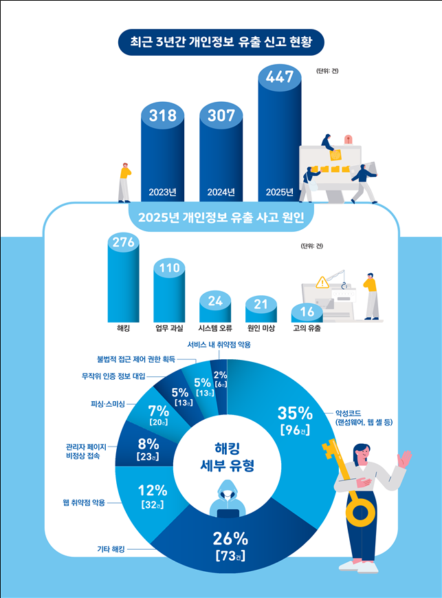
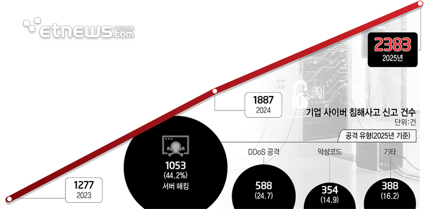
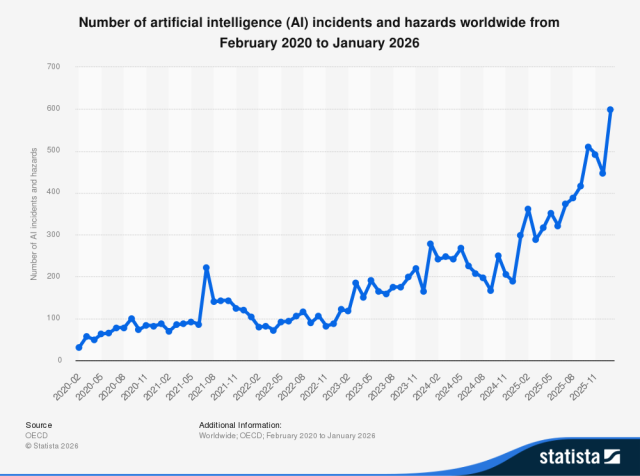
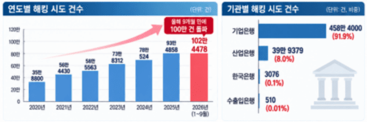
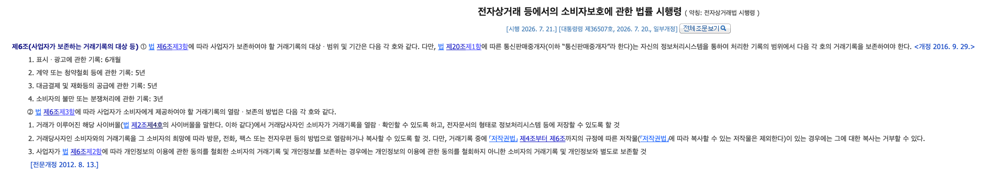

# 대 AI 에이전트 시대, 사기업이 개인정보를 계속 보유해야 할까?

작년부터 해킹과 개인정보 유출 사고로 시끄럽다. 늘고 있다는 건 알고 있었지만 어느 정도로 빈번해진 건지 궁금해서 관련 통계들을 찾아봤다.

개인정보 유출신고 현황 [https://www.mk.co.kr/news/it/12049197]

기업 사이버 침해사고 신고 건수 [https://www.etnews.com/20260127000255]

AI와 관련된 사고 건수도 증가하고 있다.

OECD 2020년 2월부터 2026년 1월까지 전 세계 인공지능(AI) 사고 및 위험 발생 건수 [Statista]

연도별, 기관별 해킹 시도 건수 (https://www.datafocus.co.kr/news/articleView.html?idxno=1152)

실제로 일하면서도 과거의 공격과는 조금 다른 느낌을 받고 있다. 예전에는 DDoS 공격이나 스캐닝, 이미 알려진 취약점을 찔러보는 요청이 대부분이었던 것 같은데 **요즘은 일반적인 클라이언트에서는 보기 어려운 요청이나 환경 정보를 가지고 접근하는 경우**도 있고, 나 AI임ㅋ 하고 **opencode나 hermes 같은 에이전트 이름을 달고 오는 것들도 모니터링**에 잡히고 있다. **예전에 유출된 AWS 키로 IAM 유저를 만들려던 시도도 로그에 opencode가 찍혀 있었다.**

[[보안] - 유출된 AWS AccessKey 무중단 교체하기: 출근길에마주한 IAM 유저 생성 시도 알림](https://sanggi-jayg.tistory.com/entry/%EC%9C%A0%EC%B6%9C%EB%90%9C-AWS-AccessKey-%EB%AC%B4%EC%A4%91%EB%8B%A8-%EA%B5%90%EC%B2%B4%ED%95%98%EA%B8%B0-%EC%B6%9C%EA%B7%BC%EA%B8%B8%EC%97%90%EB%A7%88%EC%A3%BC%ED%95%9C-IAM-%EC%9C%A0%EC%A0%80-%EC%83%9D%EC%84%B1-%EC%8B%9C%EB%8F%84-%EC%95%8C%EB%A6%BC)

물론 이런 요청이 모두 AI 에이전트를 활용한 공격이라는 증거는 없다. 그래도 이전에는 그런 정보를 달고 오는 경우가 아예 없었던 걸 생각하면 무관하지는 않은 것 같다. 금융권은 무섭겠다 증말루다가...

## 사기업의 개인정보 보유

기존에는 서비스를 제공하기 위해 기업이 개인정보를 수집하고 보관하는 것을 당연하게 여겨왔다. 커머스를 예로 들면 소셜 로그인 과정에서 이름이나 이메일 주소 등을 받아 볼 수 있고, 유저가 물건을 주문하려면 수취인 이름과 연락처, 배송지를 제공해야 한다.

**기업에서는 개인정보를 수집하고 있으니 개발과 보안부서는 개인정보 보호법을 위반하지 않기 위해서, 또 ISMS 인증을 받으려고 각종 똥꼬쇼를 하고 있다. 그렇게 해도 위에서 본 것처럼 유출 사고는 계속 터진다.**

이커머스의 경우 무슨무슨법 때문에 주문 정보를 5년 동안 보관해야 한다.

전자상거래 소비자보호 법률

그렇다면 법적으로 보관해야 하는 기간 동안 개인정보들은 **사용이 완료되었다면 암호화가 아니라 모두 익명화** 처리하면 어떨까? 아니면 개인정보에 한해 논리적 분리가 아니라 아예 **물리적으로 분리해서 서비스나 일반적인 방법으로는 접근이 아예 불가능** 하다거나? 아니면 데이터베이스 **KMS키를 회사가 아니라 국가나 제3의 기관에 맡겨 두고 일정 절차를 통해 복호화**할 수 있게 한다거나?

## 사기업의 개인정보 비보유 원칙으로

애초에 개인정보를 보유하지 않고 서비스하는 것이 가능할까? 개인정보를 보유한 채로 서비스하는 것을 너무 당연하게 여기고 있는 건 아닐까?

어렸을 때 전화번호부에는 동네 사람들의 이름, 집 주소, 전화번호가 다 공개되어 있었고, 학교에서 주는 문서나 졸업앨범에는 주소나 주민등록번호 같은 개인정보가 적혀 있었다. 지금 생각하면 "와 이걸 공개해놓았네?" 싶은 정보들인데 당시에는 이상하지도 않고 당연하기만 했다.

마찬가지로 나중에는
"옛날에는 고객 이름이랑 전화번호, 집 주소를 자기네 DB에 계속 가지고 있었대"
"ㄹㅇ?"
"ㄹㅇㄹ"
하는 시대가 올 수도 있지 않을까.

**사기업들이 원칙적으로 개인정보를 보유하지 못하게 하거나, 산업이나 분야별로 꼭 필요한 정보만 보유하도록 제한하는 건 가능할까?** 아니면 개인정보를 수집하더라도 지금처럼 일정 보관 기간 동안 보유하는 게 아니라, 짧은 기간만 쓰고 사용이 끝나면 하드 딜리트가 기본이 되는 방향은?

실제로 올해 쿠팡 유출 사고 조사 결과를 보면, ISMS-P 인증까지 받은 회사였는데도 탈퇴 후 90일이 지나면 지우기로 되어 있던 배송지 정보 246만여 건과 계좌번호 31만여 건이 그대로 남아 있었고 그중 일부는 실제 유출로 이어졌다. 지웠어야 할 데이터만 없었어도 그만큼은 털리지 않았을 거다. (https://weekly.chosun.com/news/articleView.html?idxno=52427)

**공격하는 쪽이 AI까지 들고 오는 대 AI 시대에 가장 확실한 방어는 애초에 안 가지고 있는것이 아닐까?**

그런데 막상 이렇게 작성하고 나니 개인적으로 궁금해졌다. 정말로 개인정보를 수집하지 않고도 서비스를 할 수 있을까? 아직 어떤 관련 기술들이 있는지 모르기도 하고 현실적으로 가능한 기술인지도 시간될 때 한번 찾아봐야겠다.

조금 찾아보니 미국권에서는 **1인 1키로 개인화한** **crypto-shredding(데이터 대신 암호화 키를 지워서 데이터를 못 읽게 만드는 방식) 방벙이 표준처럼 사용**한다고 하는데 표준처럼 일반화된 설계론? 개발론? 도 있는지 같이 찾아봐야겠다.
