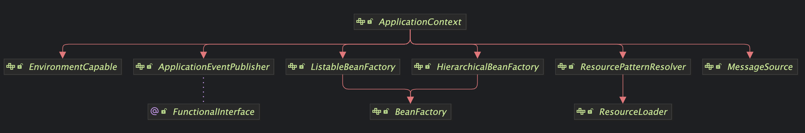
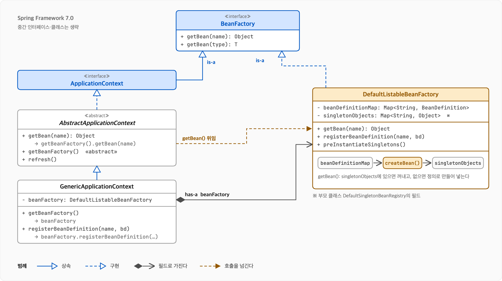
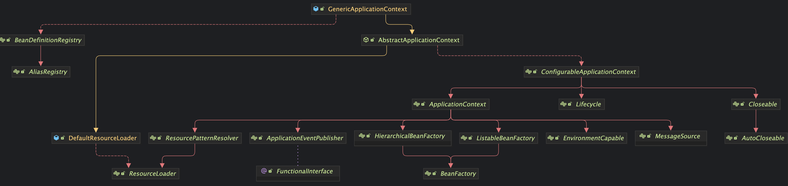
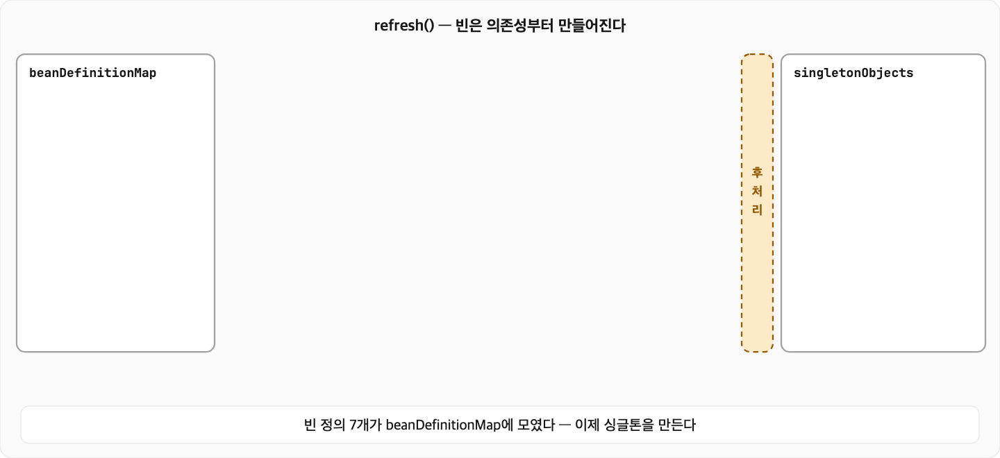
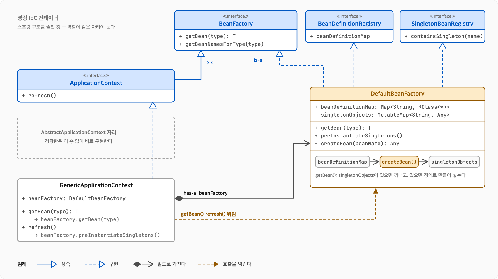

# 의존성 주입(DI) 2편: 스프링은 무엇을 대신해 주나

앞서 1편에서는 의존성 주입이 무엇이고 왜 필요한지 봤다. 이번에는 스프링 프레임워크가 그 일을 어떻게 대신해 주고 있는지 확인해보자.

## 확인 버전

- Spring Boot 4.1 (Spring Framework 7.0.9)
- Kotlin 2.3 (JDK 25)

---

## 스프링 컨테이너

### IoC(Inversion of Control) 제어의 역전

프로그램의 흐름을 내 코드가 아니라 프레임워크가 쥐는 설계 원칙이다. 내가 프레임워크를 부르는 것이 아니라 프레임워크가 내 코드를 부른다.

`IoC`라는 용어는 1988년 Ralph E. Johnson과 Brian Foote가 Journal of Object-Oriented Programming에 게재한 Designing Reusable Classes에서 처음 사용되었다고 한다. (개념 자체는 그 이전에도 있었다고 한다.)

> One important characteristic of a framework is that the methods defined by the user to tailor the framework will often be called from within the framework itself, rather than from the user's application code. The framework often plays the role of the main program in coordinating and sequencing application activity. This inversion of control gives frameworks the power to serve as extensible skeletons. The methods supplied by the user tailor the generic algorithms defined in the framework for a particular application.
>
> 프레임워크의 중요한 특징 중 하나는, 사용자가 프레임워크를 자기 용도에 맞추려고 정의한 메소드를 애플리케이션 코드가 아니라 프레임워크가 호출하는 경우가 많다는 것이다. 프레임워크는 흔히 메인 프로그램 역할을 맡아 애플리케이션의 동작을 조율하고 실행 순서를 정한다. 이 제어의 역전 덕분에 프레임워크는 확장 가능한 뼈대 역할을 할 수 있다. 사용자가 작성한 메소드는 프레임워크에 정의된 범용 알고리즘을 각 애플리케이션에 맞게 다듬는다.

### DI(Dependency Injection) 의존성 주입

`IoC`를 구현하는 방법 중 하나다. 객체가 필요한 의존성을 스스로 생성하는 게 아니라 외부에서 받는 방식이다.

```kotlin
// DI 사용하지 않을 시
@Service
class OrderFacadeService(
    // 개발자가 직접 생성하여 제어
    private val redisClient: RedisClient = RedisClient(),
    private val lockExecutor: DistributedLockExecutor = DistributedLockExecutor(redisClient),
    private val paymentClient: PaymentClient = PaymentClient(),
    private val orderRepository: OrderRepository = OrderRepository(),
    private val orderService: OrderService = OrderService(orderRepository),
) {
    // ...
}

// DI 사용 시
@Service
class OrderFacadeService(
    // 스프링 컨테이너가 생성하여 주입
    private val lockExecutor: DistributedLockExecutor,
    private val paymentClient: PaymentClient,
    private val orderService: OrderService,
) {
    // ...
}
```

`DI` 말고도 `IoC`를 구현하는 방법은 여럿 있다. 콜백, 템플릿 메소드 패턴, 옵저버 패턴이 대표적이다.
스프링은 `IoC` 컨테이너를 사용하여 객체의 생성, 연결, 수명 주기, 스코프를 관리하고 생성자 주입(권장 방법이다. 세터, 필드 주입도 가능)을 통해 의존성 관리를 한다.
`DI` 덕분에 로직 수정 없이 구현체 변경이 가능해지고 `IoC` 컨테이너 덕분에 생성 및 제어를 직접 할 필요가 없어진다.
스프링 `IoC` 컨테이너 핵심에는 `BeanFactory`와 `ApplicationContext`라는 두 인터페이스가 있다.

> The BeanFactory interface provides an advanced configuration mechanism capable of managing any type of object. ApplicationContext is a sub-interface of BeanFactory. It adds:  
>
> - Easier integration with Spring’s AOP features
> - Message resource handling (for use in internationalization)
> - Event publication
> - Application-layer specific contexts such as the WebApplicationContext for use in web applications.  
>
> In short, the BeanFactory provides the configuration framework and basic functionality, and the ApplicationContext adds more enterprise-specific functionality.
>
> BeanFactory 인터페이스는 어떤 종류의 객체든 관리할 수 있는 고급 설정 메커니즘을 제공한다. ApplicationContext는 BeanFactory의 하위 인터페이스로, 다음을 더한다.  
>
> - 스프링 AOP 기능과의 손쉬운 통합
> - 메시지 리소스 처리(국제화용)
> - 이벤트 발행
> - 웹 애플리케이션용 WebApplicationContext 같은 애플리케이션 계층 전용 컨텍스트
>
> BeanFactory는 설정 프레임워크와 기본 기능을 제공하고, ApplicationContext는 엔터프라이즈 환경에 필요한 기능을 더한다.

## BeanFactory

빈을 꺼내 주는 컨테이너다. 빈 생성과 의존성 주입은 구현 클래스 `DefaultListableBeanFactory`가 한다.

```java
public interface BeanFactory {
    Object getBean(String name) throws BeansException;
    <T> T getBean(String name, Class<T> requiredType) throws BeansException;
    Object getBean(String name, @Nullable Object @Nullable ... args) throws BeansException;
    <T> T getBean(Class<T> requiredType) throws BeansException;
    <T> T getBean(Class<T> requiredType, @Nullable Object @Nullable ... args) throws BeansException;

    <T> ObjectProvider<T> getBeanProvider(Class<T> requiredType);
    <T> ObjectProvider<T> getBeanProvider(ResolvableType requiredType);
    <T> ObjectProvider<T> getBeanProvider(ParameterizedTypeReference<T> requiredType);

    boolean containsBean(String name);
    boolean isSingleton(String name) throws NoSuchBeanDefinitionException;
    boolean isPrototype(String name) throws NoSuchBeanDefinitionException;
    boolean isTypeMatch(String name, ResolvableType typeToMatch) throws NoSuchBeanDefinitionException;
    boolean isTypeMatch(String name, Class<?> typeToMatch) throws NoSuchBeanDefinitionException;

    @Nullable Class<?> getType(String name) throws NoSuchBeanDefinitionException;
    @Nullable Class<?> getType(String name, boolean allowFactoryBeanInit) throws NoSuchBeanDefinitionException;

    String[] getAliases(String name);
}
```

`BeanFactory`의 구현 클래스 `DefaultListableBeanFactory`는 빈 정의를 등록받는 인터페이스 `BeanDefinitionRegistry`를 구현하고, 객체를 만들고 의존성을 주입하는 추상 클래스 `AbstractAutowireCapableBeanFactory`를 상속받는다.

```java
public class DefaultListableBeanFactory extends AbstractAutowireCapableBeanFactory
        implements ConfigurableListableBeanFactory, BeanDefinitionRegistry, Serializable {
    // ...
}

public interface BeanDefinitionRegistry extends AliasRegistry {
    void registerBeanDefinition(String beanName, BeanDefinition beanDefinition) throws BeanDefinitionStoreException;
    BeanDefinition getBeanDefinition(String beanName) throws NoSuchBeanDefinitionException;
    // ...
}

public abstract class AbstractAutowireCapableBeanFactory extends AbstractBeanFactory
        implements AutowireCapableBeanFactory {

    // ...

    @Override
    protected Object createBean(String beanName, RootBeanDefinition mbd, @Nullable Object @Nullable [] args)
            throws BeanCreationException {

        if (logger.isTraceEnabled()) {
            logger.trace("Creating instance of bean '" + beanName + "'");
        }
        RootBeanDefinition mbdToUse = mbd;

        // Make sure bean class is actually resolved at this point, and
        // clone the bean definition in case of a dynamically resolved Class
        // which cannot be stored in the shared merged bean definition.
        Class<?> resolvedClass = resolveBeanClass(mbd, beanName);
        if (resolvedClass != null && !mbd.hasBeanClass() && mbd.getBeanClassName() != null) {
            mbdToUse = new RootBeanDefinition(mbd);
            mbdToUse.setBeanClass(resolvedClass);
            try {
                mbdToUse.prepareMethodOverrides();
            }
            catch (BeanDefinitionValidationException ex) {
                throw new BeanDefinitionStoreException(mbdToUse.getResourceDescription(),
                        beanName, "Validation of method overrides failed", ex);
            }
        }

        try {
            // Give BeanPostProcessors a chance to return a proxy instead of the target bean instance.
            Object bean = resolveBeforeInstantiation(beanName, mbdToUse);
            if (bean != null) {
                return bean;
            }
        }
        catch (Throwable ex) {
            throw new BeanCreationException(mbdToUse.getResourceDescription(), beanName,
                    "BeanPostProcessor before instantiation of bean failed", ex);
        }

        try {
            // 생성(createBeanInstance) → 주입(populateBean) → 후처리(initializeBean)
            Object beanInstance = doCreateBean(beanName, mbdToUse, args);
            if (logger.isTraceEnabled()) {
                logger.trace("Finished creating instance of bean '" + beanName + "'");
            }
            return beanInstance;
        }
        catch (BeanCreationException | ImplicitlyAppearedSingletonException ex) {
            // A previously detected exception with proper bean creation context already,
            // or illegal singleton state to be communicated up to DefaultSingletonBeanRegistry.
            throw ex;
        }
        catch (Throwable ex) {
            throw new BeanCreationException(
                    mbdToUse.getResourceDescription(), beanName, "Unexpected exception during bean creation", ex);
        }
    }

    // ...
}
```

## ApplicationContext

`BeanFactory`를 상속하고 애플리케이션에 필요한 기능을 더한 확장 컨테이너다. 보통 "스프링 컨테이너"라고 하면 `ApplicationContext`를 가리킨다.

아래 선언을 보면 `ApplicationContext`는 `BeanFactory`를 직접 상속하지 않는다. `ListableBeanFactory`와 `HierarchicalBeanFactory`가 각각 `BeanFactory`를 상속하고, `ApplicationContext`가 이 둘을 상속하는 구조다. 그래서 `ApplicationContext`도 `BeanFactory` 타입이고, `context.getBean()`이 사용 가능하다.

```java
public interface ApplicationContext extends EnvironmentCapable, ListableBeanFactory, HierarchicalBeanFactory,
        MessageSource, ApplicationEventPublisher, ResourcePatternResolver {

    @Nullable String getId();
    String getApplicationName();
    String getDisplayName();
    long getStartupDate();

    @Nullable ApplicationContext getParent();
    AutowireCapableBeanFactory getAutowireCapableBeanFactory() throws IllegalStateException;
}
```



BeanFactory만 쓰면 `getBean()` 메소드 호출시 빈을 생성한다. ApplicationContext는 `refresh()` 메소드에서 싱글톤 빈을 미리 생성한다. 그래서 빈 설정이 잘못되었으면 애플리케이션이 뜰 때 바로 실패한다(Fail-Fast). BeanFactory는 직접 쓸 일은 거의 없다. 스프링 부트가 ApplicationContext를 만들어 주고, 스프링 문서도 특별한 이유가 없다면 ApplicationContext를 쓰라고 권한다.

`ApplicationContext`의 구현 클래스로 `GenericApplicationContext`는 `DefaultListableBeanFactory`를 `beanFactory` 멤버 변수로 가지고 있고, 빈 등록과 관리를 이 객체에 맡긴다. `context.getBean()`도 컨텍스트가 직접 처리하지 않고 이 `beanFactory` 멤버 변수에 그대로 넘긴다. `GenericApplicationContext`는 `BeanFactory`를 구현해서 `BeanFactory` 타입이면서 동시에 `BeanFactory`를 멤버 변수로 가지고 사용하는 구조다. 스프링 부트가 띄우는 컨텍스트들도 이 구현 클래스를 상속한다. (Servlet: `AnnotationConfigServletWebServerApplicationContext`, WebFlux: `AnnotationConfigReactiveWebServerApplicationContext`)



```java
public class GenericApplicationContext extends AbstractApplicationContext implements BeanDefinitionRegistry {

    private final DefaultListableBeanFactory beanFactory;
    // 생성자에서 DefaultListableBeanFactory를 생성
    public GenericApplicationContext() {
        this.beanFactory = new DefaultListableBeanFactory();
    }
    // 생성자에서 DefaultListableBeanFactory를 주입
    public GenericApplicationContext(DefaultListableBeanFactory beanFactory) {
        Assert.notNull(beanFactory, "BeanFactory must not be null");
        this.beanFactory = beanFactory;
    }

    @Override
    public final ConfigurableListableBeanFactory getBeanFactory() {
        return this.beanFactory;
    }

    @Override
    public void registerBeanDefinition(String beanName, BeanDefinition beanDefinition)
            throws BeanDefinitionStoreException {
        this.beanFactory.registerBeanDefinition(beanName, beanDefinition);
    }

    public <T> void registerBean(@Nullable String beanName, Class<T> beanClass,
            @Nullable Supplier<T> supplier, BeanDefinitionCustomizer... customizers) {
        ClassDerivedBeanDefinition beanDefinition = new ClassDerivedBeanDefinition(beanClass);
        if (supplier != null) {
            beanDefinition.setInstanceSupplier(supplier);
        }
        for (BeanDefinitionCustomizer customizer : customizers) {
            customizer.customize(beanDefinition);
        }

        String nameToUse = (beanName != null ? beanName : beanClass.getName());
        registerBeanDefinition(nameToUse, beanDefinition);
    }

    // ...
}
```



아래는 `GenericApplicationContext` 동작에 대한 테스트다.

```kotlin
class ApplicationContextTest :
    FunSpec({
        test("GenericApplicationContext 테스트") {
            // given
            val context = GenericApplicationContext()
            // 의존성의 끝단은 가짜로 채운다
            context.registerBean<DistributedLockExecutor> { mockk() }
            context.registerBean<PaymentClient> { mockk() }
            context.registerBean<OrderRepository> { mockk() }
            context.registerBean<UserRepository> { mockk() }
            context.registerBean<ProductRepository> { mockk() }
            context.registerBean<OrderService>()
            context.registerBean<OrderFacadeService>()

            // when
            context.refresh()

            // then
            // 등록한 빈 7개 검증
            context.beanDefinitionCount shouldBe 7
            // ApplicationContext 멤버 변수 beanFactory의 DefaultListableBeanFactory 타입 검증
            context.beanFactory.shouldBeInstanceOf<DefaultListableBeanFactory>()
            // OrderFacadeService 빈 싱글톤 검증
            context.getBean<OrderFacadeService>() shouldBeSameInstanceAs context.getBean<OrderFacadeService>()
            // 빈 의존성 관리 검증
            context.beanFactory.getDependenciesForBean(OrderFacadeService::class.java.name) shouldContainExactlyInAnyOrder arrayOf(
                DistributedLockExecutor::class.java.name,
                PaymentClient::class.java.name,
                OrderService::class.java.name,
            )
        }
    })
```

### 스프링 실행 시 컨테이너

앞에서 말한 `IoC`가 실제로 일어나는 곳이 여기다. `main()`에서 `runApplication()`을 부르면 스프링 부트가 `ApplicationContext` 생성 후 `refresh()` 메소드를 호출한다. 이 과정 덕분에 우리는 개발하면서 객체를 직접 생성하거나 의존성 관리를 하지 않아도 된다.

```text
main() → runApplication() → ApplicationContext 생성 → refresh()
  → 빈 정의 모으기 → 객체 생성 및 의존성 주입 → 후처리 → singletonObjects에 보관
```



이 부분은 `AbstractApplicationContext`의 `refresh()` 메소드에 있다. `GenericApplicationContext`가 이 클래스를 상속하고 있다.
(중요한 부분이라 그런지 라인 바이 라인으로 주석이 있더라)

`refresh()`에서 빈을 실제로 만드는 줄은 `finishBeanFactoryInitialization(beanFactory)`메소드다. 이 메소드가 `DefaultListableBeanFactory`의 `preInstantiateSingletons()`를 호출한다. 주석 "Instantiate all remaining (non-lazy-init) singletons."대로, 앞 단계에서 먼저 만든 후처리기 빈을 뺀 나머지 싱글톤 중 `non-lazy-init`을 여기서 생성한다.

```java
public abstract class AbstractApplicationContext extends DefaultResourceLoader
        implements ConfigurableApplicationContext {

    @Override
    public void refresh() throws BeansException, IllegalStateException {
        this.startupShutdownLock.lock();
        try {
            this.startupShutdownThread = Thread.currentThread();

            StartupStep contextRefresh = this.applicationStartup.start("spring.context.refresh");

            // Prepare this context for refreshing.
            prepareRefresh();

            // Tell the subclass to refresh the internal bean factory.
            ConfigurableListableBeanFactory beanFactory = obtainFreshBeanFactory();

            // Prepare the bean factory for use in this context.
            prepareBeanFactory(beanFactory);

            try {
                // Allows post-processing of the bean factory in context subclasses.
                postProcessBeanFactory(beanFactory);

                StartupStep beanPostProcess = this.applicationStartup.start("spring.context.beans.post-process");
                // Invoke factory processors registered as beans in the context.
                invokeBeanFactoryPostProcessors(beanFactory);
                // Register bean processors that intercept bean creation.
                registerBeanPostProcessors(beanFactory);
                beanPostProcess.end();

                // Initialize message source for this context.
                initMessageSource();

                // Initialize event multicaster for this context.
                initApplicationEventMulticaster();

                // Initialize other special beans in specific context subclasses.
                onRefresh();

                // Check for listener beans and register them.
                registerListeners();

                // Instantiate all remaining (non-lazy-init) singletons.
                finishBeanFactoryInitialization(beanFactory);

                // Last step: publish corresponding event.
                finishRefresh();
            }

            catch (RuntimeException | Error ex) {
                if (logger.isWarnEnabled()) {
                    logger.warn("Exception encountered during context initialization - " +
                            "cancelling refresh attempt: " + ex);
                }

                // Stop already started Lifecycle beans to avoid dangling resources.
                if (this.lifecycleProcessor != null && this.lifecycleProcessor.isRunning()) {
                    try {
                        this.lifecycleProcessor.stop();
                    }
                    catch (Throwable ex2) {
                        logger.warn("Exception thrown from LifecycleProcessor on cancelled refresh", ex2);
                    }
                }

                // Destroy already created singletons to avoid dangling resources.
                destroyBeans();

                // Reset 'active' flag.
                cancelRefresh(ex);

                // Propagate exception to caller.
                throw ex;
            }

            finally {
                contextRefresh.end();
            }
        }
        finally {
            this.startupShutdownThread = null;
            this.startupShutdownLock.unlock();
        }
    }
}
```

### ApplicationContext 상속 인터페이스 역할

**ListableBeanFactory**: 빈을 하나씩이 아니라 목록으로 조회할 수 있게 해준다. 같은 타입의 빈을 `List`나 `Map`으로 한 번에 주입받을 수 있다.

```kotlin
@Service
class AnnouncementService(
    private val channels: List<NotificationChannel>,
    private val channelMap: Map<String, NotificationChannel>,
)
```

**HierarchicalBeanFactory**: 부모 컨텍스트를 둘 수 있다. 자식에서 못 찾은 빈은 부모에서 찾는다. 반대로 부모는 자식의 빈을 볼 수 없다. 스프링 부트 앱에서 직접 쓸 일은 드물다.

```kotlin
SpringApplicationBuilder()
    .parent(CommonConfig::class.java)    // 부모: 공통 빈을 둔다
    .child(ChildApplication::class.java) // 자식: 부모의 빈도 꺼내 쓸 수 있다
    .run(*args)
```

**EnvironmentCapable**: 프로퍼티와 활성 프로필을 담은 `Environment`를 꺼내 준다(`getEnvironment()`). 스프링은 이 값을 보고 `@Profile`에 맞는 빈만 등록하고, `@Value`의 `${...}` 자리를 채운다.

```kotlin
interface FileStorage

@Profile("local")
@Component
class LocalFileStorage : FileStorage

@Profile("prod")
@Component
class S3FileStorage : FileStorage

// 환경에 알맞은 구현체가 주입된다
@Service
class FileService(
    private val fileStorage: FileStorage,
)
```

프로퍼티 값은 `@Value`로 받는다.

```kotlin
@Component
class DistributedLockExecutor(
    private val redisClient: RedisClient,
    @Value("\${lock.wait-time}") private val waitTime: Duration,
)
```

**MessageSource**: 메시지 키와 로케일로 그 언어의 메시지를 꺼내 준다.

```kotlin
// messages.properties: order.not-found=주문 {0}을 찾을 수 없습니다
// messages_en.properties: order.not-found=Order {0} not found
context.getMessage("order.not-found", arrayOf(orderId), Locale.KOREA)
context.getMessage("order.not-found", arrayOf(orderId), Locale.ENGLISH)
```

**ApplicationEventPublisher**: 이벤트를 발행한다. 발행하는 쪽은 누가 듣는지 모르고, 리스너 메소드는 내 코드가 아니라 스프링이 호출한다.

```kotlin
data class OrderCreatedEvent(val orderId: Long)

@Service
class OrderFacadeService(
    // ...
    private val eventPublisher: ApplicationEventPublisher,
) {
    fun createOrder() {
        // ...
        eventPublisher.publishEvent(OrderCreatedEvent(orderId))
    }
}

@Component
class OrderNotificationListener {

    // 스프링이 호출한다
    @EventListener
    fun handle(event: OrderCreatedEvent) {
        // ...
    }
}
```

**ResourcePatternResolver**: 패턴으로 리소스를 찾는다. 컴포넌트 스캔도 이 기능으로 `.class` 파일을 찾는다.

```kotlin
context.getResources("classpath*:com/example/**/*.class")
```

```java
public interface ResourcePatternResolver extends ResourceLoader {
    String CLASSPATH_ALL_URL_PREFIX = "classpath*:";
    Resource[] getResources(String locationPattern) throws IOException;
}
```

## 경량 IoC 컨테이너 직접 만들어 보기

스프링 `IoC` 컨테이너의 핵심 기능만 추려서 구현해보면 아래 정도로 정리된다.



### 인터페이스

```kotlin
interface BeanFactory {
    fun <T : Any> getBean(type: KClass<T>): T
    fun getBeanNamesForType(type: KClass<*>): Set<String>
}

interface BeanDefinitionRegistry {
    val beanDefinitionMap: Map<String, KClass<*>>
}

interface SingletonBeanRegistry {
    fun containsSingleton(beanName: String): Boolean
}

interface ApplicationContext : BeanFactory {
    fun refresh()
}
```

### 예외

```kotlin
class BeanDefinitionOverrideException(
    beanName: String,
) : RuntimeException("Cannot register bean definition $beanName")

class NoSuchBeanDefinitionException(
    beanName: String,
) : RuntimeException("No bean named $beanName")

class NoUniqueBeanDefinitionException(
    beanName: String,
    foundBeanNames: Set<String>,
) : RuntimeException("No unique bean definition found for bean name '$beanName', found: $foundBeanNames")
```

### BeanFactory 구현

```kotlin
class DefaultBeanFactory(
    vararg classes: KClass<*>,
) : BeanFactory,
    BeanDefinitionRegistry,
    SingletonBeanRegistry {

    private val singletonObjects = mutableMapOf<String, Any>()

    override val beanDefinitionMap: Map<String, KClass<*>> = buildMap {
        classes.forEach { type ->
            val beanName = type.simpleName!! // 간소화: 클래스 이름 그대로 빈 이름으로 사용
            if (beanName in this) throw BeanDefinitionOverrideException(beanName)
            put(beanName, type)
        }
    }

    /** 타입으로 빈을 찾는다. 인터페이스로 찾아도 되고, 처음 찾는 빈이면 만들어서 캐시에 넣어 둔다. */
    override fun <T : Any> getBean(type: KClass<T>): T {
        val beanName = type.simpleName!!
        val beanNames = getBeanNamesForType(type)
        if (beanNames.isEmpty()) throw NoSuchBeanDefinitionException(beanName)
        if (beanNames.size > 1) throw NoUniqueBeanDefinitionException(beanName, beanNames)

        val targetBeanName = beanNames.first()
        val bean = singletonObjects.getOrPut(targetBeanName) {
            createBean(targetBeanName)
        }
        return type.cast(bean)
    }

    /** 이 타입으로 꺼낼 수 있는 빈 이름을 모두 찾는다. */
    override fun getBeanNamesForType(type: KClass<*>): Set<String> {
        return beanDefinitionMap.filter { it.value.isSubclassOf(type) }.keys
    }

    /** 이미 만들어 둔 빈인지 확인한다. */
    override fun containsSingleton(beanName: String): Boolean {
        return singletonObjects.containsKey(beanName)
    }

    /** 등록된 빈을 전부 미리 만들어 둔다. */
    fun preInstantiateSingletons() {
        beanDefinitionMap.values.forEach { getBean(it) }
    }

    /** 주 생성자로 빈을 만든다. 생성자에 필요한 빈은 getBean으로 가져온다. */
    private fun createBean(beanName: String): Any {
        val constructor = beanDefinitionMap.getValue(beanName).primaryConstructor!!
        val arguments = constructor.parameters.map { getBean(it.type.classifier as KClass<*>) }
        return constructor.call(*arguments.toTypedArray())
    }
}
```

### ApplicationContext 구현

```kotlin
class GenericApplicationContext(
    vararg classes: KClass<*>,
) : ApplicationContext {

    val beanFactory: DefaultBeanFactory = DefaultBeanFactory(*classes)

    override fun <T : Any> getBean(type: KClass<T>): T {
        return this.beanFactory.getBean(type)
    }

    override fun getBeanNamesForType(type: KClass<*>): Set<String> {
        return this.beanFactory.getBeanNamesForType(type)
    }

    /** 빈을 미리 다 만들어 둔다. 실제 일은 beanFactory가 한다. */
    override fun refresh() {
        this.beanFactory.preInstantiateSingletons()
    }
}
```

---

## 참고

- https://www.laputan.org/drc/drc.html
- https://docs.spring.io/spring-framework/reference/core/beans/introduction.html
- https://medium.com/@vkekukh/why-they-ask-whats-the-difference-between-ioc-and-dependency-injection-9cb1101c0a41
