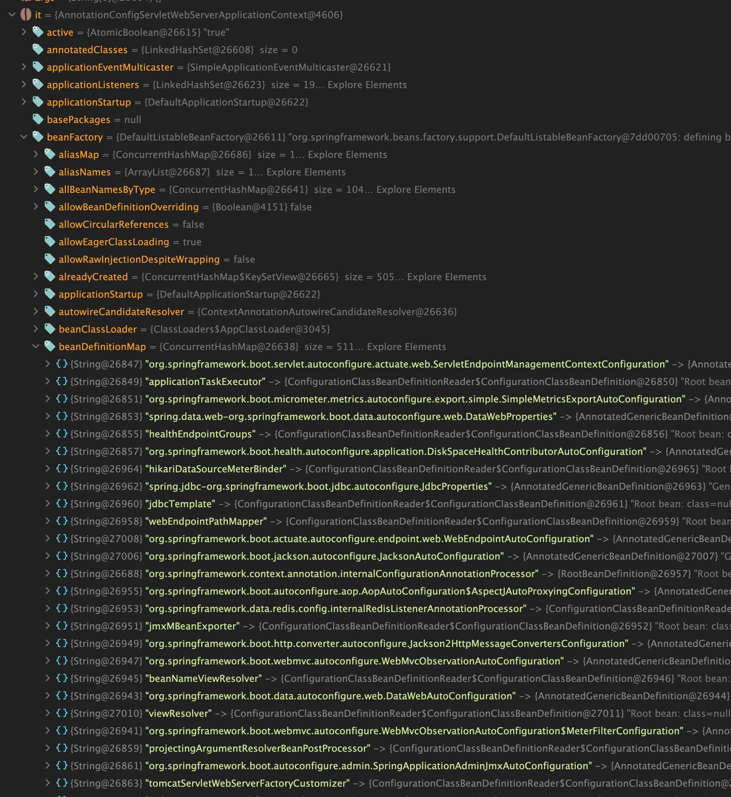
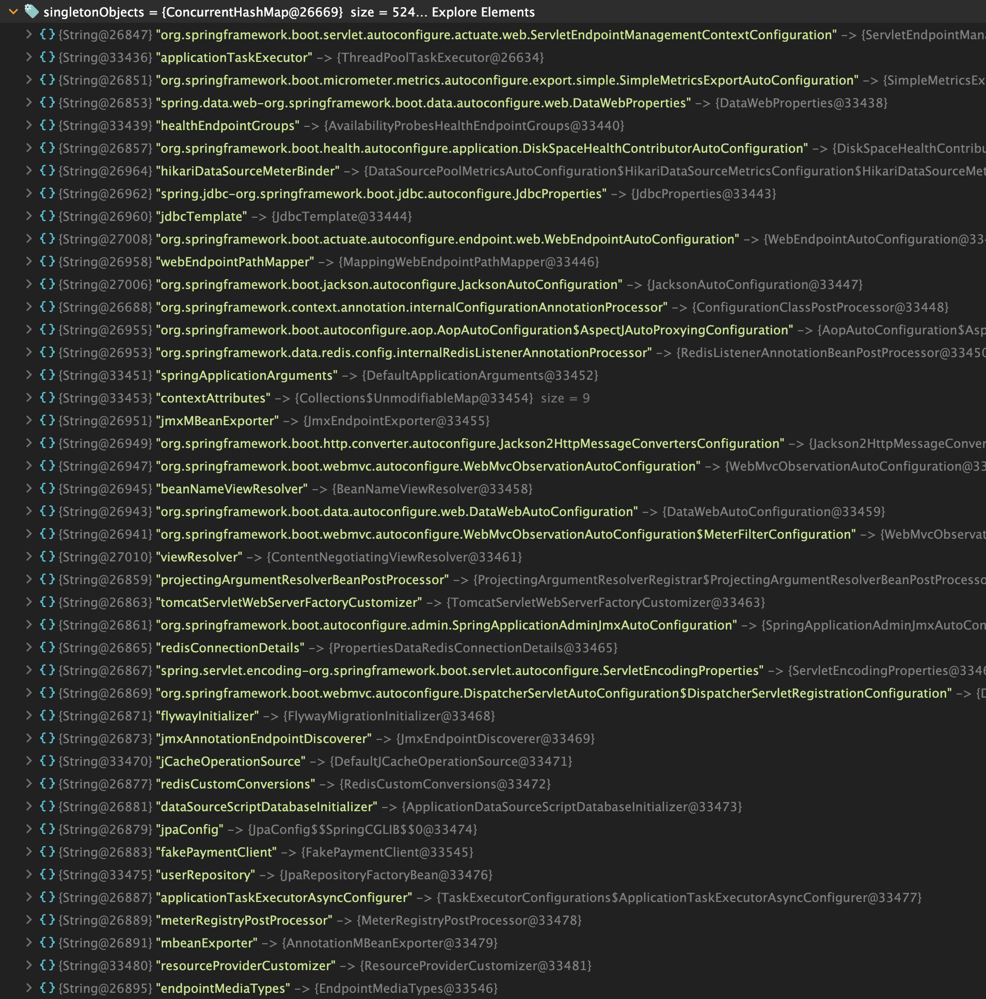
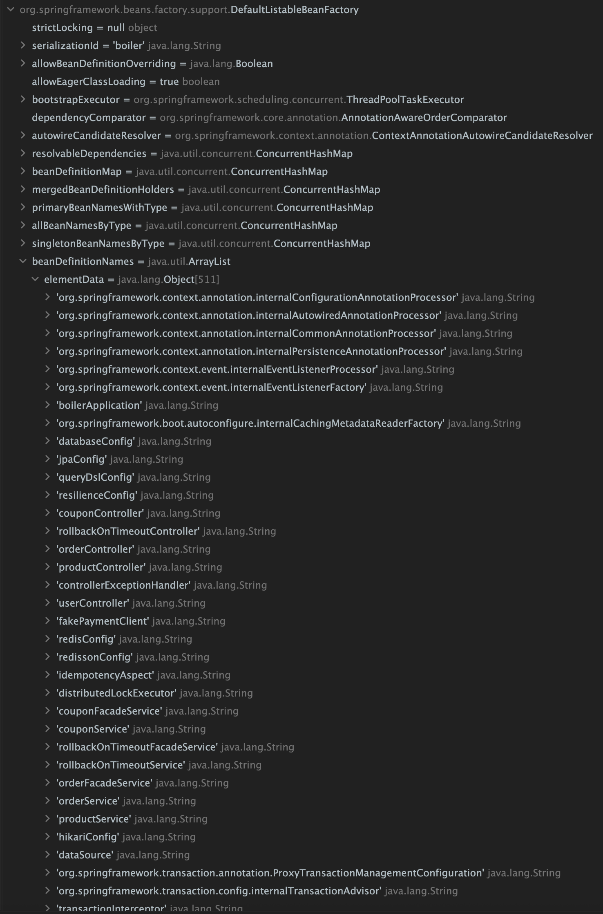
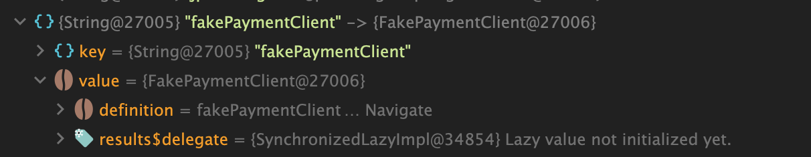
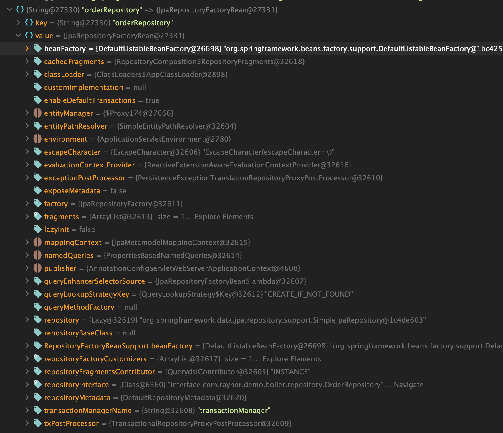
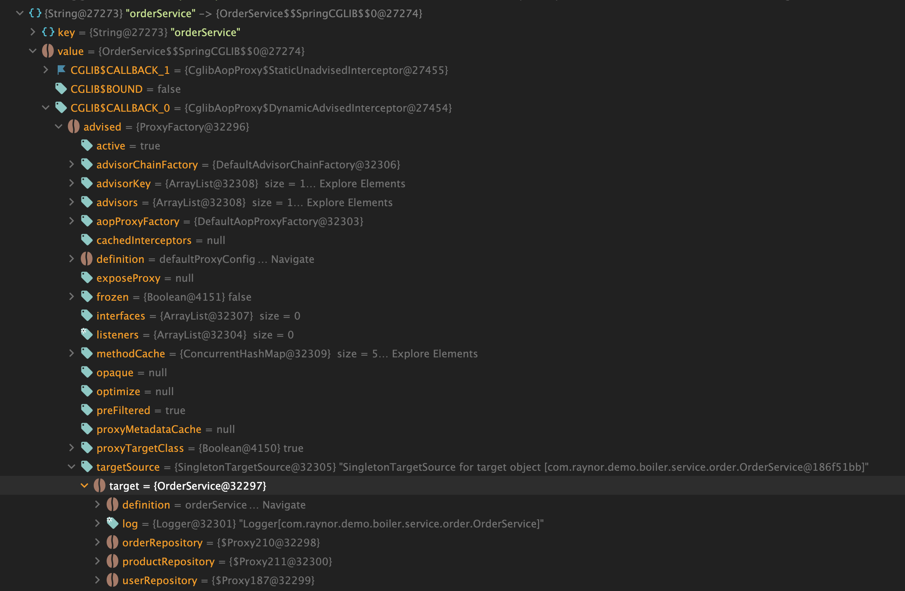

이번에는 스프링 부트를 실행했을 때 빈이 실제로 어떻게 만들어져 있는지 확인해 보자.

## 스프링 부트 실행 시

### 디버거

애플리케이션을 디버그 모드로 실행해 생성된 빈을 확인해 보자.




DefaultListableBeanFactory 인스턴스 내 beanDefinitionNames 필드에 511개 요소를 가지고 있고 프레임워크에서 필요한 + 내가 구현한 클래스들로
JpaCofnig, RedisConfig 등 설정 클래스들과 OrderController, FakePaymentClient, UserRepository 등의 API 동작을 수행할 클래스 등도 같이 있는것을 확인할 수 있다.



### 로그 레벨

스프링 부트 어플리케이션 설정에서 스프링 프레임워크의 로그 레벨을 DEBUG로 변경하면 빈 생성이 어떻게 되는지 로그를 통해 확인할 수 있다.

```yaml
logging:
  level:
    org.springframework: DEBUG
```

```text
2026-10-17T20:35:26.053+09:00 DEBUG 86300 --- [boiler] [           main] o.s.boot.SpringApplication               : Loading source class com.raynor.demo.boiler.BoilerApplication
2026-10-17T20:35:26.155+09:00 DEBUG 86300 --- [boiler] [           main] ConfigServletWebServerApplicationContext : Refreshing org.springframework.boot.web.server.servlet.context.AnnotationConfigServletWebServerApplicationContext@3f3c7bdb
2026-10-17T20:35:26.181+09:00 DEBUG 86300 --- [boiler] [           main] o.s.b.f.s.DefaultListableBeanFactory     : Creating shared instance of singleton bean 'org.springframework.context.annotation.internalConfigurationAnnotationProcessor'
2026-10-17T20:35:26.199+09:00 DEBUG 86300 --- [boiler] [           main] o.s.b.f.s.DefaultListableBeanFactory     : Creating shared instance of singleton bean 'org.springframework.boot.autoconfigure.internalCachingMetadataReaderFactory'
2026-10-17T20:35:26.360+09:00 DEBUG 86300 --- [boiler] [           main] o.s.c.a.ClassPathBeanDefinitionScanner   : Identified candidate component class: file [/Users/raynor/workspace/kotlin-spring-boot-demos/boiler/build/classes/kotlin/main/com/raynor/demo/boiler/config/DatabaseConfig.class]
2026-10-17T20:35:26.369+09:00 DEBUG 86300 --- [boiler] [           main] o.s.c.a.ClassPathBeanDefinitionScanner   : Identified candidate component class: file [/Users/raynor/workspace/kotlin-spring-boot-demos/boiler/build/classes/kotlin/main/com/raynor/demo/boiler/config/JpaConfig.class]
2026-10-17T20:35:26.371+09:00 DEBUG 86300 --- [boiler] [           main] o.s.c.a.ClassPathBeanDefinitionScanner   : Identified candidate component class: file [/Users/raynor/workspace/kotlin-spring-boot-demos/boiler/build/classes/kotlin/main/com/raynor/demo/boiler/config/QueryDslConfig.class]
2026-10-17T20:35:26.378+09:00 DEBUG 86300 --- [boiler] [           main] o.s.c.a.ClassPathBeanDefinitionScanner   : Identified candidate component class: file [/Users/raynor/workspace/kotlin-spring-boot-demos/boiler/build/classes/kotlin/main/com/raynor/demo/boiler/config/ResilienceConfig.class]
2026-10-17T20:35:26.403+09:00 DEBUG 86300 --- [boiler] [           main] o.s.c.a.ClassPathBeanDefinitionScanner   : Identified candidate component class: file [/Users/raynor/workspace/kotlin-spring-boot-demos/boiler/build/classes/kotlin/main/com/raynor/demo/boiler/controller/coupon/CouponController.class]
2026-10-17T20:35:26.414+09:00 DEBUG 86300 --- [boiler] [           main] o.s.c.a.ClassPathBeanDefinitionScanner   : Identified candidate component class: file [/Users/raynor/workspace/kotlin-spring-boot-demos/boiler/build/classes/kotlin/main/com/raynor/demo/boiler/controller/lab/RollbackOnTimeoutController.class]
2026-10-17T20:35:26.422+09:00 DEBUG 86300 --- [boiler] [           main] o.s.c.a.ClassPathBeanDefinitionScanner   : Identified candidate component class: file [/Users/raynor/workspace/kotlin-spring-boot-demos/boiler/build/classes/kotlin/main/com/raynor/demo/boiler/controller/order/OrderController.class]
2026-10-17T20:35:26.432+09:00 DEBUG 86300 --- [boiler] [           main] o.s.c.a.ClassPathBeanDefinitionScanner   : Identified candidate component class: file [/Users/raynor/workspace/kotlin-spring-boot-demos/boiler/build/classes/kotlin/main/com/raynor/demo/boiler/controller/product/ProductController.class]
2026-10-17T20:35:26.444+09:00 DEBUG 86300 --- [boiler] [           main] o.s.c.a.ClassPathBeanDefinitionScanner   : Identified candidate component class: file [/Users/raynor/workspace/kotlin-spring-boot-demos/boiler/build/classes/kotlin/main/com/raynor/demo/boiler/controller/support/ControllerExceptionHandler.class]
2026-10-17T20:35:26.446+09:00 DEBUG 86300 --- [boiler] [           main] o.s.c.a.ClassPathBeanDefinitionScanner   : Identified candidate component class: file [/Users/raynor/workspace/kotlin-spring-boot-demos/boiler/build/classes/kotlin/main/com/raynor/demo/boiler/controller/user/UserController.class]
2026-10-17T20:35:26.479+09:00 DEBUG 86300 --- [boiler] [           main] o.s.c.a.ClassPathBeanDefinitionScanner   : Identified candidate component class: file [/Users/raynor/workspace/kotlin-spring-boot-demos/boiler/build/classes/kotlin/main/com/raynor/demo/boiler/infra/payment/FakePaymentClient.class]
2026-10-17T20:35:26.485+09:00 DEBUG 86300 --- [boiler] [           main] o.s.c.a.ClassPathBeanDefinitionScanner   : Identified candidate component class: file [/Users/raynor/workspace/kotlin-spring-boot-demos/boiler/build/classes/kotlin/main/com/raynor/demo/boiler/infra/redis/config/RedisConfig.class]
2026-10-17T20:35:26.486+09:00 DEBUG 86300 --- [boiler] [           main] o.s.c.a.ClassPathBeanDefinitionScanner   : Identified candidate component class: file [/Users/raynor/workspace/kotlin-spring-boot-demos/boiler/build/classes/kotlin/main/com/raynor/demo/boiler/infra/redis/config/RedissonConfig.class]
2026-10-17T20:35:26.491+09:00 DEBUG 86300 --- [boiler] [           main] o.s.c.a.ClassPathBeanDefinitionScanner   : Identified candidate component class: file [/Users/raynor/workspace/kotlin-spring-boot-demos/boiler/build/classes/kotlin/main/com/raynor/demo/boiler/infra/redis/idempotency/IdempotencyAspect.class]
2026-10-17T20:35:26.493+09:00 DEBUG 86300 --- [boiler] [           main] o.s.c.a.ClassPathBeanDefinitionScanner   : Identified candidate component class: file [/Users/raynor/workspace/kotlin-spring-boot-demos/boiler/build/classes/kotlin/main/com/raynor/demo/boiler/infra/redis/lock/DistributedLockExecutor.class]
2026-10-17T20:35:26.504+09:00 DEBUG 86300 --- [boiler] [           main] o.s.c.a.ClassPathBeanDefinitionScanner   : Identified candidate component class: file [/Users/raynor/workspace/kotlin-spring-boot-demos/boiler/build/classes/kotlin/main/com/raynor/demo/boiler/service/coupon/CouponFacadeService.class]
2026-10-17T20:35:26.507+09:00 DEBUG 86300 --- [boiler] [           main] o.s.c.a.ClassPathBeanDefinitionScanner   : Identified candidate component class: file [/Users/raynor/workspace/kotlin-spring-boot-demos/boiler/build/classes/kotlin/main/com/raynor/demo/boiler/service/coupon/CouponService.class]
2026-10-17T20:35:26.509+09:00 DEBUG 86300 --- [boiler] [           main] o.s.c.a.ClassPathBeanDefinitionScanner   : Identified candidate component class: file [/Users/raynor/workspace/kotlin-spring-boot-demos/boiler/build/classes/kotlin/main/com/raynor/demo/boiler/service/lab/RollbackOnTimeoutFacadeService.class]
2026-10-17T20:35:26.509+09:00 DEBUG 86300 --- [boiler] [           main] o.s.c.a.ClassPathBeanDefinitionScanner   : Identified candidate component class: file [/Users/raynor/workspace/kotlin-spring-boot-demos/boiler/build/classes/kotlin/main/com/raynor/demo/boiler/service/lab/RollbackOnTimeoutService.class]
2026-10-17T20:35:26.510+09:00 DEBUG 86300 --- [boiler] [           main] o.s.c.a.ClassPathBeanDefinitionScanner   : Identified candidate component class: file [/Users/raynor/workspace/kotlin-spring-boot-demos/boiler/build/classes/kotlin/main/com/raynor/demo/boiler/service/order/OrderFacadeService.class]
2026-10-17T20:35:26.511+09:00 DEBUG 86300 --- [boiler] [           main] o.s.c.a.ClassPathBeanDefinitionScanner   : Identified candidate component class: file [/Users/raynor/workspace/kotlin-spring-boot-demos/boiler/build/classes/kotlin/main/com/raynor/demo/boiler/service/order/OrderService.class]
2026-10-17T20:35:26.517+09:00 DEBUG 86300 --- [boiler] [           main] o.s.c.a.ClassPathBeanDefinitionScanner   : Identified candidate component class: file [/Users/raynor/workspace/kotlin-spring-boot-demos/boiler/build/classes/kotlin/main/com/raynor/demo/boiler/service/product/ProductService.class]
...
2026-10-17T20:35:37.352+09:00 DEBUG 86300 --- [boiler] [           main] o.s.d.r.c.s.RepositoryFactorySupport     : Finished creation of repository instance for com.raynor.demo.boiler.repository.CouponRepository.
2026-10-17T20:35:37.361+09:00 DEBUG 86300 --- [boiler] [           main] o.s.b.f.s.DefaultListableBeanFactory     : Creating shared instance of singleton bean 'userRepository'
2026-10-17T20:35:37.368+09:00 DEBUG 86300 --- [boiler] [           main] o.s.b.f.s.DefaultListableBeanFactory     : Creating shared instance of singleton bean 'jpa.named-queries#4'
2026-10-17T20:35:37.370+09:00 DEBUG 86300 --- [boiler] [           main] o.s.b.f.s.DefaultListableBeanFactory     : Creating shared instance of singleton bean 'jpa.UserRepository.fragments#0'
2026-10-17T20:35:37.373+09:00 DEBUG 86300 --- [boiler] [           main] o.s.d.r.c.s.RepositoryFactorySupport     : Initializing repository instance for com.raynor.demo.boiler.repository.UserRepository…
2026-10-17T20:35:37.377+09:00 DEBUG 86300 --- [boiler] [           main] o.s.d.r.c.s.RepositoryFactorySupport     : Finished creation of repository instance for com.raynor.demo.boiler.repository.UserRepository.
2026-10-17T20:35:37.383+09:00 DEBUG 86300 --- [boiler] [           main] o.s.b.f.s.DefaultListableBeanFactory     : Autowiring by type from bean name 'couponService' via constructor to bean named 'couponSchemeRepository'
2026-10-17T20:35:37.383+09:00 DEBUG 86300 --- [boiler] [           main] o.s.b.f.s.DefaultListableBeanFactory     : Autowiring by type from bean name 'couponService' via constructor to bean named 'couponRepository'
2026-10-17T20:35:37.383+09:00 DEBUG 86300 --- [boiler] [           main] o.s.b.f.s.DefaultListableBeanFactory     : Autowiring by type from bean name 'couponService' via constructor to bean named 'userRepository'
2026-10-17T20:35:37.436+09:00 DEBUG 86300 --- [boiler] [           main] o.s.b.f.s.DefaultListableBeanFactory     : Creating shared instance of singleton bean 'distributedLockExecutor'
2026-10-17T20:35:37.439+09:00 DEBUG 86300 --- [boiler] [           main] o.s.b.f.s.DefaultListableBeanFactory     : Creating shared instance of singleton bean 'redisson'
2026-10-17T20:35:37.440+09:00 DEBUG 86300 --- [boiler] [           main] o.s.b.f.s.DefaultListableBeanFactory     : Creating shared instance of singleton bean 'org.redisson.spring.starter.RedissonAutoConfigurationV4'
2026-10-17T20:35:37.444+09:00 DEBUG 86300 --- [boiler] [           main] o.s.b.f.s.DefaultListableBeanFactory     : Creating shared instance of singleton bean 'redissonCustomizer'
2026-10-17T20:35:37.444+09:00 DEBUG 86300 --- [boiler] [           main] o.s.b.f.s.DefaultListableBeanFactory     : Creating shared instance of singleton bean 'redissonConfig'
2026-10-17T20:35:37.449+09:00 DEBUG 86300 --- [boiler] [           main] o.s.b.f.s.DefaultListableBeanFactory     : Creating shared instance of singleton bean 'spring.redis.redisson-org.redisson.spring.starter.RedissonProperties'
2026-10-17T20:35:37.468+09:00 DEBUG 86300 --- [boiler] [           main] o.s.b.f.s.DefaultListableBeanFactory     : Creating shared instance of singleton bean 'spring.data.redis-org.springframework.boot.data.redis.autoconfigure.DataRedisProperties'
2026-10-17T20:35:37.479+09:00 DEBUG 86300 --- [boiler] [           main] o.s.b.f.s.DefaultListableBeanFactory     : Creating shared instance of singleton bean 'redisConnectionDetails'
2026-10-17T20:35:37.479+09:00 DEBUG 86300 --- [boiler] [           main] o.s.b.f.s.DefaultListableBeanFactory     : Creating shared instance of singleton bean 'org.springframework.boot.data.redis.autoconfigure.DataRedisAutoConfiguration'
2026-10-17T20:35:37.481+09:00 DEBUG 86300 --- [boiler] [           main] o.s.b.f.s.DefaultListableBeanFactory     : Autowiring by type from bean name 'redisConnectionDetails' via factory method to bean named 'spring.data.redis-org.springframework.boot.data.redis.autoconfigure.DataRedisProperties'
2026-10-17T20:35:37.551+09:00  INFO 86300 --- [boiler] [           main] org.redisson.Version                     : Redisson 4.7.0
2026-10-17T20:35:37.707+09:00  WARN 86300 --- [boiler] [           main] i.n.r.d.DnsServerAddressStreamProviders  : Can not find io.netty.resolver.dns.macos.MacOSDnsServerAddressStreamProvider in the classpath, fallback to system defaults. This may result in incorrect DNS resolutions on MacOS. Check whether you have a dependency on 'io.netty:netty-resolver-dns-native-macos'
2026-10-17T20:35:37.997+09:00  INFO 86300 --- [boiler] [isson-netty-1-5] o.redisson.connection.ConnectionsHolder  : 1 connections initialized for localhost/127.0.0.1:6501
2026-10-17T20:35:38.108+09:00  INFO 86300 --- [boiler] [sson-netty-1-20] o.redisson.connection.ConnectionsHolder  : 24 connections initialized for localhost/127.0.0.1:6501
2026-10-17T20:35:38.175+09:00 DEBUG 86300 --- [boiler] [           main] o.s.b.f.s.DefaultListableBeanFactory     : Autowiring by type from bean name 'distributedLockExecutor' via constructor to bean named 'redisson'
2026-10-17T20:35:38.177+09:00 DEBUG 86300 --- [boiler] [           main] o.s.b.f.s.DefaultListableBeanFactory     : Autowiring by type from bean name 'couponFacadeService' via constructor to bean named 'couponService'
2026-10-17T20:35:38.178+09:00 DEBUG 86300 --- [boiler] [           main] o.s.b.f.s.DefaultListableBeanFactory     : Autowiring by type from bean name 'couponFacadeService' via constructor to bean named 'distributedLockExecutor'
2026-10-17T20:35:38.192+09:00 DEBUG 86300 --- [boiler] [           main] o.s.b.f.s.DefaultListableBeanFactory     : Autowiring by type from bean name 'couponController' via constructor to bean named 'couponFacadeService'
2026-10-17T20:35:38.194+09:00 DEBUG 86300 --- [boiler] [           main] o.s.b.f.s.DefaultListableBeanFactory     : Creating shared instance of singleton bean 'rollbackOnTimeoutController'
2026-10-17T20:35:38.209+09:00 DEBUG 86300 --- [boiler] [           main] o.s.b.f.s.DefaultListableBeanFactory     : Creating shared instance of singleton bean 'rollbackOnTimeoutService'
2026-10-17T20:35:38.211+09:00 DEBUG 86300 --- [boiler] [           main] o.s.b.f.s.DefaultListableBeanFactory     : Autowiring by type from bean name 'rollbackOnTimeoutService' via constructor to bean named 'userRepository'
2026-10-17T20:35:38.221+09:00 DEBUG 86300 --- [boiler] [           main] o.s.b.f.s.DefaultListableBeanFactory     : Creating shared instance of singleton bean 'rollbackOnTimeoutFacadeService'
2026-10-17T20:35:38.222+09:00 DEBUG 86300 --- [boiler] [           main] o.s.b.f.s.DefaultListableBeanFactory     : Autowiring by type from bean name 'rollbackOnTimeoutFacadeService' via constructor to bean named 'rollbackOnTimeoutService'
2026-10-17T20:35:38.231+09:00 DEBUG 86300 --- [boiler] [           main] o.s.b.f.s.DefaultListableBeanFactory     : Autowiring by type from bean name 'rollbackOnTimeoutController' via constructor to bean named 'rollbackOnTimeoutService'
2026-10-17T20:35:38.231+09:00 DEBUG 86300 --- [boiler] [           main] o.s.b.f.s.DefaultListableBeanFactory     : Autowiring by type from bean name 'rollbackOnTimeoutController' via constructor to bean named 'rollbackOnTimeoutFacadeService'
2026-10-17T20:35:38.232+09:00 DEBUG 86300 --- [boiler] [           main] o.s.b.f.s.DefaultListableBeanFactory     : Creating shared instance of singleton bean 'orderController'
2026-10-17T20:35:38.240+09:00 DEBUG 86300 --- [boiler] [           main] o.s.b.f.s.DefaultListableBeanFactory     : Creating shared instance of singleton bean 'orderFacadeService'
2026-10-17T20:35:38.246+09:00 DEBUG 86300 --- [boiler] [           main] o.s.b.f.s.DefaultListableBeanFactory     : Creating shared instance of singleton bean 'fakePaymentClient'
2026-10-17T20:35:38.252+09:00 DEBUG 86300 --- [boiler] [           main] o.s.b.f.s.DefaultListableBeanFactory     : Creating shared instance of singleton bean 'orderService'
2026-10-17T20:35:38.254+09:00 DEBUG 86300 --- [boiler] [           main] o.s.b.f.s.DefaultListableBeanFactory     : Creating shared instance of singleton bean 'orderRepository'
2026-10-17T20:35:38.257+09:00 DEBUG 86300 --- [boiler] [           main] o.s.b.f.s.DefaultListableBeanFactory     : Creating shared instance of singleton bean 'jpa.named-queries#2'
2026-10-17T20:35:38.261+09:00 DEBUG 86300 --- [boiler] [           main] o.s.b.f.s.DefaultListableBeanFactory     : Creating shared instance of singleton bean 'jpa.OrderRepository.fragments#0'
2026-10-17T20:35:38.264+09:00 DEBUG 86300 --- [boiler] [           main] o.s.b.f.s.DefaultListableBeanFactory     : Creating shared instance of singleton bean 'orderQueryDslRepositoryImplFragment'
2026-10-17T20:35:38.265+09:00 DEBUG 86300 --- [boiler] [           main] o.s.b.f.s.DefaultListableBeanFactory     : Creating shared instance of singleton bean 'orderQueryDslRepositoryImpl'
2026-10-17T20:35:38.267+09:00 DEBUG 86300 --- [boiler] [           main] o.s.b.f.s.DefaultListableBeanFactory     : Autowiring by type from bean name 'orderQueryDslRepositoryImpl' via constructor to bean named 'jpaQueryFactory'
2026-10-17T20:35:38.278+09:00 DEBUG 86300 --- [boiler] [           main] o.s.d.r.c.s.RepositoryFactorySupport     : Initializing repository instance for com.raynor.demo.boiler.repository.OrderRepository…
2026-10-17T20:35:38.309+09:00 DEBUG 86300 --- [boiler] [           main] o.s.d.jpa.repository.query.NamedQuery    : Looking up named query 'Order.findTopByOrderByIdDesc'
2026-10-17T20:35:38.310+09:00 DEBUG 86300 --- [boiler] [           main] o.s.d.jpa.repository.query.NamedQuery    : Did not find named query Order.findTopByOrderByIdDesc
2026-10-17T20:35:38.318+09:00 DEBUG 86300 --- [boiler] [           main] o.s.d.r.c.s.RepositoryFactorySupport     : Finished creation of repository instance for com.raynor.demo.boiler.repository.OrderRepository.
2026-10-17T20:35:38.326+09:00 DEBUG 86300 --- [boiler] [           main] o.s.b.f.s.DefaultListableBeanFactory     : Creating shared instance of singleton bean 'productRepository'
2026-10-17T20:35:38.332+09:00 DEBUG 86300 --- [boiler] [           main] o.s.b.f.s.DefaultListableBeanFactory     : Creating shared instance of singleton bean 'jpa.named-queries#1'
2026-10-17T20:35:38.334+09:00 DEBUG 86300 --- [boiler] [           main] o.s.b.f.s.DefaultListableBeanFactory     : Creating shared instance of singleton bean 'jpa.ProductRepository.fragments#0'
2026-10-17T20:35:38.334+09:00 DEBUG 86300 --- [boiler] [           main] o.s.b.f.s.DefaultListableBeanFactory     : Creating shared instance of singleton bean 'productQueryDslRepositoryImplFragment'
2026-10-17T20:35:38.334+09:00 DEBUG 86300 --- [boiler] [           main] o.s.b.f.s.DefaultListableBeanFactory     : Creating shared instance of singleton bean 'productQueryDslRepositoryImpl'
2026-10-17T20:35:38.336+09:00 DEBUG 86300 --- [boiler] [           main] o.s.b.f.s.DefaultListableBeanFactory     : Autowiring by type from bean name 'productQueryDslRepositoryImpl' via constructor to bean named 'jpaQueryFactory'
2026-10-17T20:35:38.345+09:00 DEBUG 86300 --- [boiler] [           main] o.s.d.r.c.s.RepositoryFactorySupport     : Initializing repository instance for com.raynor.demo.boiler.repository.ProductRepository…
2026-10-17T20:35:38.373+09:00 DEBUG 86300 --- [boiler] [           main] o.s.d.jpa.repository.query.NamedQuery    : Looking up named query 'Product.findByIdAndDeletedAtIsNull'
2026-10-17T20:35:38.373+09:00 DEBUG 86300 --- [boiler] [           main] o.s.d.jpa.repository.query.NamedQuery    : Did not find named query Product.findByIdAndDeletedAtIsNull
2026-10-17T20:35:38.375+09:00 DEBUG 86300 --- [boiler] [           main] o.s.d.jpa.repository.query.NamedQuery    : Looking up named query 'Product.findAllByIdInAndDeletedAtIsNullAndStatus'
2026-10-17T20:35:38.375+09:00 DEBUG 86300 --- [boiler] [           main] o.s.d.jpa.repository.query.NamedQuery    : Did not find named query Product.findAllByIdInAndDeletedAtIsNullAndStatus
2026-10-17T20:35:38.378+09:00 DEBUG 86300 --- [boiler] [           main] o.s.d.r.c.s.RepositoryFactorySupport     : Finished creation of repository instance for com.raynor.demo.boiler.repository.ProductRepository.
```

### 힙 덤프

힙 덤프를 통해서도 확인이 가능하다. 아래 명령어로 실행중인 자바 프로세스의 힙 덤프를 뜰 수 있다.

```bash
# 명령어 실행 후 덤프 대상의 PID 확인, 혹은 스프링 부트 실행시 INFO 로그로도 출력 된다.
jps -l


# 덤프 뜨기
jcmd <pid> GC.heap_dump <dump_file_name>.hprof
```



### FakePaymentClient



FakePaymentClient는 생성자로 만든 객체가 그대로 singletonObjects에 들어 있다.

### OrderRepository



리포지토리 대신 리포지토리를 만들어 주는 JpaRepositoryFactoryBean이 들어 있다. 실제로 주입되는 것은 이것이 만든 프록시다.

### OrderService



`@Transactional` 어노테이션을 사용하는 OrderService는 Proxy 객체로 있는 것을 확인할 수 있다.
생성한 원본 객체는 `advised.targetSource.target`에 있고 프록시를 통해 호출되면 원본 객체를 사용한다.
그래서 같은 클래스 안에서 메소드 호출시 프록시를 거치지 않아서 호출 당하는 메소드의 `@Transactional` 어노테이션은 무시 되고
private 함수도 어노테이션을 사용할 수 없게되는 이유다.
